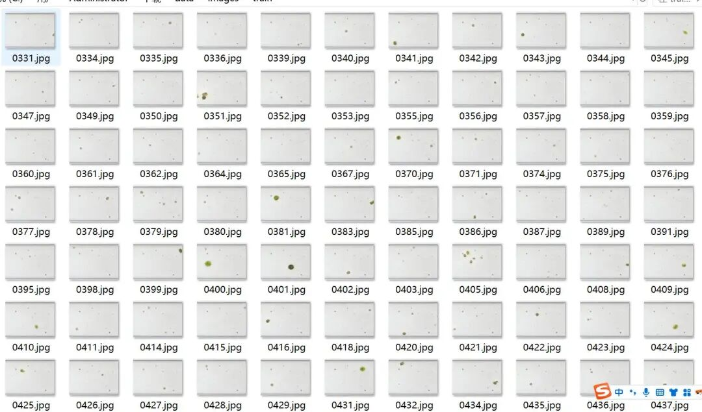
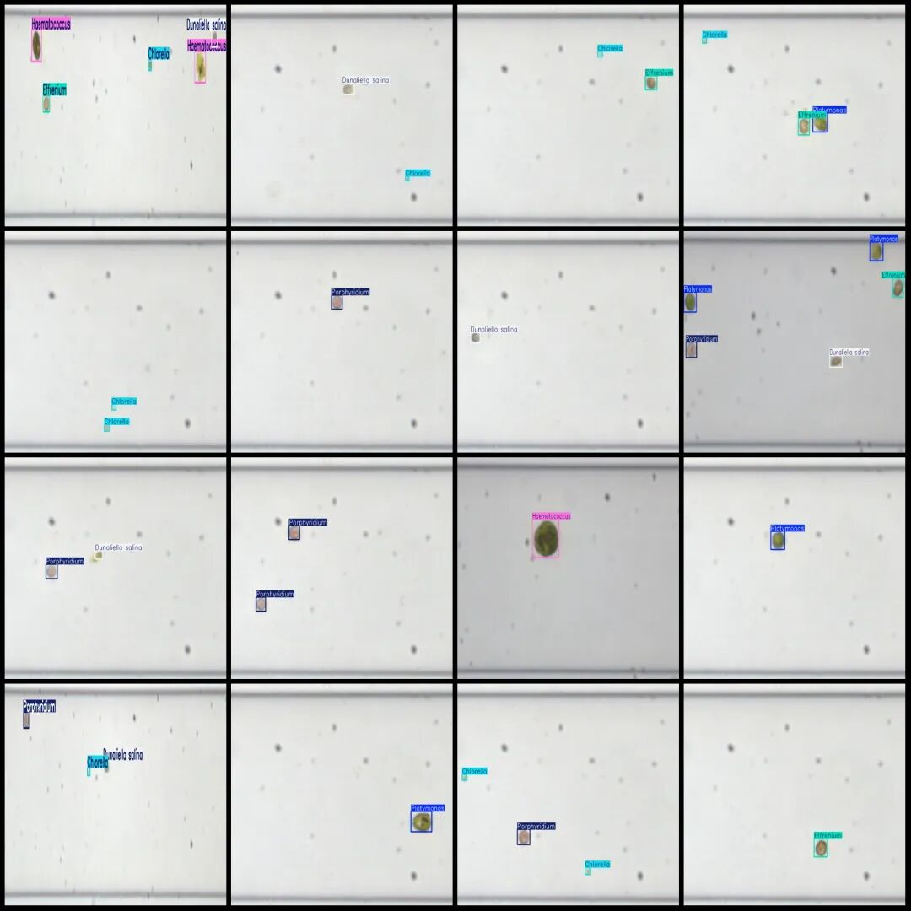
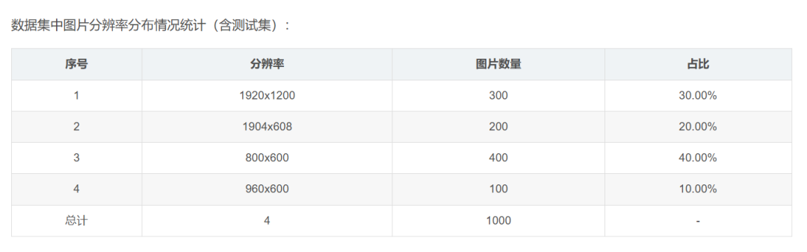

# Microalgae cell detection dataset in YOLO format with 703 images and 6 categories

Dataset format: YOLO format (containing only jpg images and corresponding yolo format txt files)

Number of images (number of jpg files): 703

Number of annotations (number of xml files): 703

Number of annotations (number of txt files): 703

Label count: 6

Label category names (note that the order of yolo format categories does not correspond to this, but is based on the labels folder's classes.txt): ["Platymonas", "Chlorella", "Dunaliella salina", "Effrenium", "Porphyridium", "Haematococcus"]

Number of boxes labeled in each category:

Platymonas frame count = 184

Chlorella frame count = 722

Dunaliella salina frame count = 234

Effrenium frame count = 227

Porphyridium frame count = 272

Haematococcus frame count = 119

Total frames: 1758

Using labelImg:

Annotation rules: Draw a rectangle around the category.

Important Notice: No

Special : This dataset does not guarantee the accuracy or precision of the trained models or weight files. The dataset is provided with accurate and reasonable annotations only.

Image Preview:

Annotation example:

## Payment

Here is a pay link on Stripe ( https://buy.stripe.com/3cs8yP7sY87d0vu9AB ). Please contact me lonlonago@foxmail.com after funding $89, and I will send you a complete data files , thank you!

